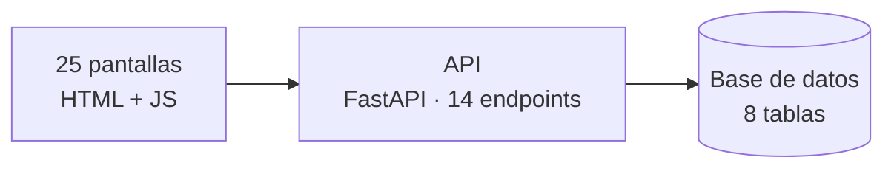
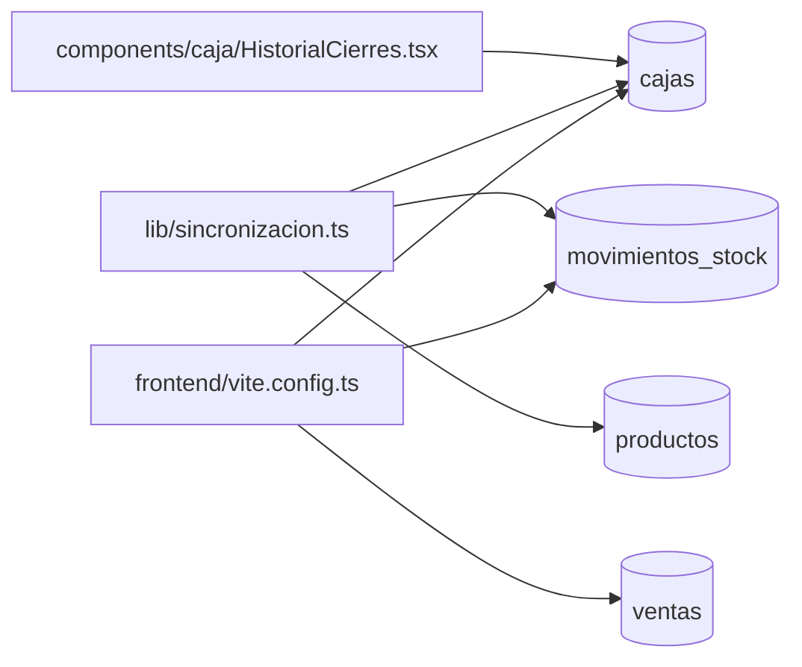

# Arquitectura · kioskardo

Generado leyendo el repo. **No editar a mano**: lo regenera el CI en cada commit.

Todo lo que figura acá está escrito en el código. Nada está inferido por un modelo de lenguaje: si algo no se puede probar leyendo el repo, no aparece.

## Las piezas

## Qué datos toca cada pantalla

Las tablas principales de cada pantalla. El detalle completo está abajo.

## Librerías

De dónde sale: la versión, de `requirements*.txt`; el uso, de los `import` de cada archivo. Una librería declarada que nadie importa se nota.

| Librería | Versión | Quién la usa |
|---|---|---|
| `alembic` | 1.20.0 | `backend/alembic/env.py`, `backend/alembic/versions/2026_09_30_1251-8311a5d866a1_modelo_inicial.py`, `backend/alembic/versions/2026_09_30_1940-af146e38f60e_pagos_por_venta_e_items_varios.py`, `backend/alembic/versions/2026_10_01_1634-3f0c08c167e0_motivo_de_stock_anulacion.py` |
| `fastapi` | 0.142.2 | `backend/app/kiosko.py`, `backend/app/main.py`, `backend/app/rutas/cajas.py`, `backend/app/rutas/productos.py` y 3 más |
| `psycopg` | 3.3.6 | sin import directo |
| `pydantic-settings` | 2.15.0 | sin import directo |
| `pytest` | 9.1.1 | `backend/tests/conftest.py` |
| `ruff` | 0.16.9 | sin import directo |
| `sqlalchemy` | 2.1.1 | `backend/alembic/env.py`, `backend/alembic/versions/2026_09_30_1251-8311a5d866a1_modelo_inicial.py`, `backend/alembic/versions/2026_09_30_1940-af146e38f60e_pagos_por_venta_e_items_varios.py`, `backend/alembic/versions/2026_10_01_1634-3f0c08c167e0_motivo_de_stock_anulacion.py` y 9 más |

<b>Desglose por pantalla</b> — endpoints y tablas, uno por uno

### frontend/index.html

- Endpoints que usa: **0**
- Tablas que tocan esos endpoints: —

### components/EstadoConexion.tsx

- Endpoints que usa: **1**
- Tablas que tocan esos endpoints: —

| Método | Endpoint | Función | Tablas |
|---|---|---|---|
| GET | `/api/salud` | `salud` | — |

### components/caja/HistorialCierres.tsx

- Endpoints que usa: **1**
- Tablas que tocan esos endpoints: `cajas`

| Método | Endpoint | Función | Tablas |
|---|---|---|---|
| GET | `/api/cajas` | `historial_cierres` | cajas |

### layouts/AppLayout.tsx

- Endpoints que usa: **0**
- Tablas que tocan esos endpoints: —

### lib/sincronizacion.ts

- Endpoints que usa: **4**
- Tablas que tocan esos endpoints: `cajas`, `movimientos_stock`, `productos`

| Método | Endpoint | Función | Tablas |
|---|---|---|---|
| GET | `/api/cajas/abierta` | `caja_abierta` | cajas |
| PUT | `/api/cajas/{caja_id}` | `abrir_caja` | cajas |
| GET | `/api/cajas/{caja_id}` | `detalle_caja` | — |
| GET | `/api/productos` | `listar_productos` | movimientos_stock, productos |

### main.tsx

- Endpoints que usa: **0**
- Tablas que tocan esos endpoints: —

### pages/PantallaClientePage.tsx

- Endpoints que usa: **0**
- Tablas que tocan esos endpoints: —

### frontend/vite.config.ts

- Endpoints que usa: **14**
- Tablas que tocan esos endpoints: `cajas`, `movimientos_caja`, `movimientos_stock`, `productos`, `venta_items`, `venta_pagos`, `ventas`

| Método | Endpoint | Función | Tablas |
|---|---|---|---|
| GET | `/api/cajas` | `historial_cierres` | cajas |
| GET | `/api/cajas/abierta` | `caja_abierta` | cajas |
| PUT | `/api/cajas/{caja_id}` | `abrir_caja` | cajas |
| GET | `/api/cajas/{caja_id}` | `detalle_caja` | — |
| POST | `/api/cajas/{caja_id}/cerrar` | `cerrar_caja` | — |
| GET | `/api/cajas/{caja_id}/movimientos` | `movimientos_de_caja` | movimientos_caja |
| POST | `/api/cajas/{caja_id}/movimientos` | `registrar_movimiento` | movimientos_caja |
| GET | `/api/cajas/{caja_id}/ventas` | `ventas_de_caja` | ventas |
| GET | `/api/productos` | `listar_productos` | movimientos_stock, productos |
| PUT | `/api/productos/{producto_id}` | `guardar_producto` | productos |
| POST | `/api/productos/{producto_id}/movimientos-stock` | `registrar_movimiento_stock` | movimientos_stock |
| GET | `/api/salud` | `salud` | — |
| PUT | `/api/ventas/{venta_id}` | `registrar_venta` | cajas, movimientos_stock, productos, venta_items, venta_pagos, ventas |
| POST | `/api/ventas/{venta_id}/anular` | `anular_venta` | cajas, movimientos_stock, ventas |

## Lo que no se pudo probar

- Endpoints que ninguna pantalla nombra: **0**. Pueden ser internos, llamarse con la ruta armada en tiempo de ejecución, o estar muertos.
- Tablas declaradas: **8**; las que no aparecen arriba no las toca ningún endpoint que el front nombre.
